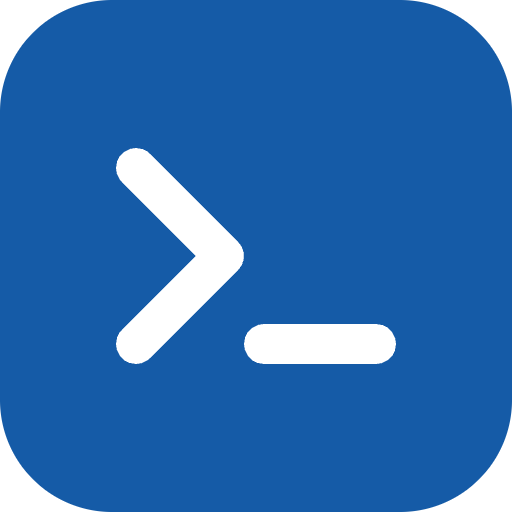

<p align="center">
  <a href="https://clidoc.ben3d.ca" target="_blank" rel="noopener noreferrer">
    
  </a>
</p>
<br/>
<p align="center">
  <a href="https://npmjs.com/package/@clidoc/cli"></a>
  <a href="https://www.npmtrends.com/@clidoc/cli"></a>
  <a href="https://codecov.io/gh/bhouston/clidoc"></a>
  <a href="https://discord.gg/vSYc5CfRWH"></a>
  <a href="https://clidoc.ben3d.ca"></a>
</p>
<br/>

# clidoc

> Generate CLI reference docs that never drift from your code.

- 📄 Docs Generated From Your CLI
- 🔌 Yargs, Commander, and oclif
- ✅ Validated OpenCLI Documents
- 📚 Docusaurus and VitePress Pages
- 🐚 Completions and MCP Tools

Stop hand-writing your CLI reference docs. Generate them from your yargs, Commander
or oclif definitions so they never drift from `--help`, then publish them to Docusaurus,
VitePress or plain Markdown.

clidoc turns your CLI definitions into a portable
[OpenCLI](https://github.com/bcdxn/opencli) document, which it validates and renders as
Markdown, shell completions and MCP tools.

[Read the Docs to Learn More](https://clidoc.ben3d.ca).

## Packages

| Package                                     | Version (click for changelogs)                                                                                                              |
| ------------------------------------------- | :------------------------------------------------------------------------------------------------------------------------------------------ |
| [`@clidoc/cli`](packages/cli)               | [](https://github.com/bhouston/clidoc/releases)               |
| [`@clidoc/core`](packages/core)             | [](https://github.com/bhouston/clidoc/releases)             |
| [`@clidoc/yargs`](packages/yargs)           | [](https://github.com/bhouston/clidoc/releases)           |
| [`@clidoc/commander`](packages/commander)   | [](https://github.com/bhouston/clidoc/releases)   |
| [`@clidoc/oclif`](packages/oclif)           | [](https://github.com/bhouston/clidoc/releases)           |
| [`@clidoc/docusaurus`](packages/docusaurus) | [](https://github.com/bhouston/clidoc/releases) |
| [`@clidoc/vitepress`](packages/vitepress)   | [](https://github.com/bhouston/clidoc/releases)   |

Runnable examples live in [`demos/`](demos) (Yargs, Commander, oclif, Docusaurus, VitePress).

## Quick Start

```sh
npm install @clidoc/yargs @clidoc/core   # or @clidoc/commander / @clidoc/oclif
npm install -g @clidoc/cli
```

```sh
mycli docgen --output cli.json                          # your CLI writes the document
clidoc validate cli.json                                # check it against the OpenCLI schema
clidoc markdown cli.json --output reference.md          # render the reference
```

Adding the `docgen` command to your CLI takes a few lines; see
[Yargs](packages/yargs), [Commander](packages/commander) or [oclif](packages/oclif).
The clidoc tool documents itself this way, from its own `yargs-file-commands` definitions.

## Why clidoc

- **Hand-written reference pages** drift as flags change. clidoc reads the definitions your CLI already runs, and your hand-written guides stay next to the generated pages.
- **`--help` only** is unstructured terminal text. A validated OpenCLI document also gives you a Markdown reference, a docs-site section, shell completions and MCP tool definitions.
- **`oclif readme`** generates command docs for oclif projects only, into a README. clidoc works across Yargs, Commander and oclif, and publishes to docs sites.

The framework packages read metadata only. They don't infer custom validation, coercion or middleware (see
[Compatibility and scope](#compatibility-and-scope)).

## MCP support

Export MCP tool definitions with `clidoc mcp cli.json -o tools.json`, or serve a
trusted local executable with
`clidoc mcp cli.json --serve --executable /absolute/path/to/mycli`.
See the [MCP guide](packages/docs/docs/mcp.md) for client configuration,
argument mapping, process limits, and the `@clidoc/cli/mcp` library API.

## Run from source

For repository development, use the Node version in `.nvmrc` and pnpm specified in `package.json`.

```sh
git clone https://github.com/bhouston/clidoc.git
cd clidoc
pnpm install --frozen-lockfile
pnpm build
node packages/cli/dist/bin.js --help
node packages/cli/dist/bin.js validate docs/generated/clidoc.json
node packages/cli/dist/bin.js markdown docs/generated/clidoc.json
```

The upstream OpenCLI submodule is optional. Already cloned? Run
`git submodule update --init --recursive` to enable tests that compare the bundled
schema and validate upstream examples. Without the submodule, those tests skip
with a warning and the remaining tests run normally.

## Validate specifications in CI

Use [clidoc-action](https://github.com/bhouston/clidoc-action) to reject invalid
OpenCLI specifications in pull requests:

```yaml
- uses: actions/checkout@d23441a48e516b6c34aea4fa41551a30e30af803 # v6
- uses: bhouston/clidoc-action@v1
  with:
    files: opencli.json
    specification: bcdxn
    format: json
```

The action accepts JSON/YAML, multiple files, explicit specification dialects,
and pinned validator versions. Its default uses a locked source build; set
`validator-version` to pin an exact published `@clidoc/core` version. See the
[official CI guide](https://clidoc.ben3d.ca/docs/github-action/) for a complete
workflow and version selection. This repository runs the hosted action against
its generated CLI specification on Linux.

The standalone action is also available as the optional HTTPS submodule
[`submodules/clidoc-action`](https://github.com/bhouston/clidoc-action).
Initialize it with `git submodule update --init submodules/clidoc-action` to
work on the action alongside the monorepo. Consuming the hosted action requires
no submodule checkout.

## Generate from your CLI

Add a human-facing `docgen` command to the CLI you document. It should use the
same command metadata as the running CLI and write an OpenCLI document as JSON
or Markdown:

```sh
npm install -g @clidoc/cli
mycli docgen --output cli.json
mycli docgen --format markdown --output reference.md
clidoc validate cli.json
```

For machine discovery, also attach the hidden `__opencli` subcommand, matching
[upstream OpenCLI's Go libraries](https://github.com/bcdxn/opencli). With no
flags it writes one UTF-8 OpenCLI JSON document followed by a newline to
stdout and exits with status 0; `-o`/`--out <file>` (upstream's own flag)
writes it to a file instead. `@clidoc/core` exports an async
`handleOpenCliRequest(argv, document)` helper that checks argv for `__opencli`
before your framework parses the command line, so handlers never run:

```ts
import { handleOpenCliRequest } from '@clidoc/core';

if (!(await handleOpenCliRequest(process.argv.slice(2), buildDocument))) {
  // parse and run the CLI as usual
}
```

For example, `mycli __opencli > mycli.opencli.json` or
`mycli __opencli --out mycli.opencli.json` both capture the document. The
[Yargs](packages/yargs), [Commander](packages/commander), and
[oclif](packages/oclif) framework guides and runnable demos show this.

## Use the pipeline as a library

```ts
import { fromCommander } from '@clidoc/commander';
import { renderMarkdown, validate } from '@clidoc/core';

const document = fromCommander(program, {
  title: 'My CLI',
  binary: 'my-cli',
  version: '1.0.0',
});
const result = validate(document);
if (!result.valid) throw new Error(result.errors.join('\n'));
const markdown = renderMarkdown(document);
```

Add author-supplied metadata a generator can't infer &mdash; examples, exit
codes, license, install methods &mdash; with `mergeDocument`:

```ts
import { mergeDocument } from '@clidoc/core';

const documented = mergeDocument(document, {
  info: { license: { name: 'MIT', spdxId: 'MIT' } },
  commands: {
    'my-cli greet': {
      examples: [{ title: 'Basic', content: 'my-cli greet Ada' }],
      exitCodes: [{ code: 1, status: 'BAD_USER_INPUT_ERROR', summary: 'Missing name' }],
    },
  },
});
```

`generatePages(document, { basePath: '/reference' })` returns stable page IDs,
titles, URL paths, and Markdown content. Both site consumers use that mapping.
Use different base paths and dedicated generated directories for multiple CLIs.
Hand-written guides stay as ordinary Markdown alongside generated reference pages.

## Demos and dogfooding

```sh
pnpm build
pnpm --filter @clidoc/demo-yargs start greet Ada --tag demo --language fr
pnpm --filter @clidoc/demo-commander start greet Ada --tag demo
pnpm --filter @clidoc/demo-oclif start Ada

pnpm dev
```

`pnpm build` builds every package and demo. `pnpm dev` starts the website and
demo site dev servers together: the main website on port 4000, the
Docusaurus demo on 4001, and the VitePress demo on 4002.

Each CLI demo supports `docgen --output cli.json` for humans and the hidden
`__opencli` subcommand for machine discovery, e.g.
`pnpm --filter @clidoc/demo-yargs start __opencli`. The Yargs
demo uses barebones Yargs; the clidoc tool uses `defineCommand` and
`fileCommands`, following the structure used by
[hdrify](https://github.com/bhouston/hdrify). `clidoc` itself dogfoods this
same workflow: `clidoc docgen` and `clidoc __opencli` describe the `clidoc`
binary.

The [CLI reference](https://clidoc.ben3d.ca/docs/cli/reference) comes from the actual
command modules. `pnpm build` writes the OpenCLI JSON and Markdown to `docs/generated/`
(not committed) before building the demo sites that read them. The website is
deployed by the Release workflow from each release tag, so it documents the
released version.

## Example document

Trimmed from `docs/generated/clidoc.json`, the document clidoc generates for itself
(`pnpm build` writes it):

```json
{
  "opencliVersion": "1.0.0-alpha.14",
  "info": {
    "title": "clidoc",
    "binary": "clidoc",
    "summary": "Generate, validate, and publish CLI documentation through OpenCLI."
  },
  "commands": {
    "clidoc validate": {
      "summary": "Validate an OpenCLI JSON or YAML document",
      "args": [
        {
          "name": "input",
          "required": true,
          "type": "string",
          "summary": "OpenCLI document filename"
        }
      ]
    }
  }
}
```

## Compatibility and scope

The contract is **OpenCLI `1.0.0-alpha.14`**, pinned to upstream commit
`683d0ca92fc37ccc2626e64db0a8c32f3c4063c0` in [`upstream/opencli`](upstream/opencli).
The core package bundles that schema, so installed packages validate offline
without the submodule. Tests compare the bundled schema and upstream fixtures when
the submodule is checked out.
The upstream Go project retains its own license; see
[third-party attribution](packages/core/THIRD_PARTY_NOTICES.md).

The OpenCLI schema only requires `commands` keys to be strings; it does not mandate a
format. Upstream's Go generator decorates keys for display, e.g.
`"petstore pet add <arguments> [flags]"`. clidoc emits the plain `binary sub command` path
instead, as shown above, because page titles, route slugs, and `commands[...]` lookups all
want that exact string. Both forms validate against the schema, and `clidoc validate`
accepts upstream's decorated documents unchanged.

Framework metadata cannot express every runtime behavior. The framework packages document
what their supported metadata exposes; they do not infer custom validation,
coercion, middleware, or application behavior. See each framework package README for limits.
Schema validation follows the upstream JSON Schema and is paired with the logical
checks ported from upstream's `validate/validate.go` (argument ordering, variadic
constraints, `$FILE` config references, duplicate flags), rather than claiming
identical behavior to every semantic check in the Go CLI.

This first implementation focuses on the CLI-to-Markdown pipeline. OpenAPI and
TypeDoc ingestion, a standalone embeddable React viewer, additional site platforms,
and an integrated preview server remain extensions to that pipeline.

## Local checks and releasing

Follow [CONTRIBUTING.md](CONTRIBUTING.md): issue first, issue-numbered branch,
Conventional Commits, checks, then a PR against `main`.

```sh
pnpm lint
pnpm tsc
pnpm test --coverage
pnpm audit --audit-level=high
pnpm package:check
pnpm docs:build
```

Coverage must be at least 95% for statements, branches, functions, and lines. Completion
execution tests require Bash, Zsh, and Fish on `PATH` (`brew install fish` on macOS;
`sudo apt-get install zsh fish` on Ubuntu). Run `pnpm docs:build` when changing generated
CLI documentation or docs integrations.

The repository follows a standard TypeScript toolchain: pnpm workspaces, TypeScript builds,
Vitest, Oxlint/Oxfmt, Husky/commitlint, MIT licensing, and independent manually dispatched
semantic releases.

## Releases

See [RELEASING.md](RELEASING.md) for how releases are published and [GitHub Releases](https://github.com/bhouston/clidoc/releases) for changes.

## Contribution

See [Contributing Guide](CONTRIBUTING.md).

## License

MIT

## Author

[Ben Houston](https://ben3d.ca), Sponsored by [Land of Assets](https://landofassets.com).
