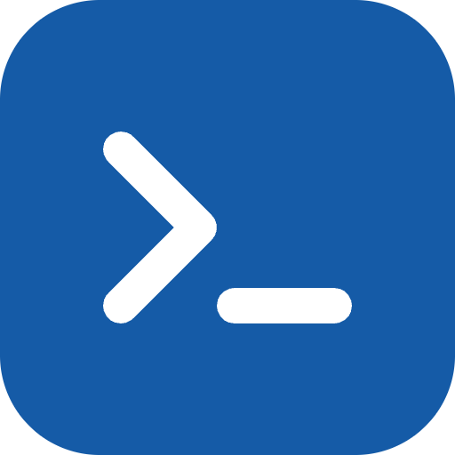

<p align="center">
  <a href="https://clidoc.dev" target="_blank" rel="noopener noreferrer">
    
  </a>
</p>
<br/>
<p align="center">
  <a href="https://npmjs.com/package/@clidoc/core"></a>
  <a href="https://www.npmtrends.com/@clidoc/core"></a>
  <a href="https://codecov.io/gh/bhouston/clidoc"></a>
  <a href="https://discord.gg/vSYc5CfRWH"></a>
  <a href="https://clidoc.dev"></a>
</p>
<br/>

# @clidoc/core

> OpenCLI types, offline validation, and Markdown rendering for CLI docs.

- 📦 Schema Bundled for Offline Use
- 🔎 JSON and YAML Parsing
- 📝 Markdown and Page Generation
- 🧩 Merge Author Metadata
- 🐚 Completion Script Generation

Parse, validate and render CLI documentation from one portable [OpenCLI 1.0.0-alpha.14](https://github.com/bcdxn/opencli) document. This is the library underneath every clidoc package: use it directly if you already have an OpenCLI document, or pair it with a framework package to generate one from your CLI.

[Read the Docs to Learn More](https://clidoc.dev).

## Getting Started

```sh
npm install @clidoc/core
```

```ts
import { parse, validate, renderMarkdown, generatePages } from '@clidoc/core';

const document = parse(sourceText); // JSON or YAML; throws on invalid input
const result = validate(document); // { valid, errors }
const markdown = renderMarkdown(document);
const pages = generatePages(document, { basePath: '/cli' });
```

The published package bundles the exact schema pinned in `upstream/opencli/spec.schema.json`, so validation works offline.

## Where it fits

| You want to                                                        | Use                                                                                                                                                                                                      |
| ------------------------------------------------------------------ | -------------------------------------------------------------------------------------------------------------------------------------------------------------------------------------------------------- |
| Generate a document from your CLI                                  | [`@clidoc/yargs`](https://www.npmjs.com/package/@clidoc/yargs), [`@clidoc/commander`](https://www.npmjs.com/package/@clidoc/commander) or [`@clidoc/oclif`](https://www.npmjs.com/package/@clidoc/oclif) |
| Validate, render Markdown, completions or MCP tools from the shell | [`@clidoc/cli`](https://www.npmjs.com/package/@clidoc/cli)                                                                                                                                               |
| Publish reference pages in your docs site                          | [`@clidoc/docusaurus`](https://www.npmjs.com/package/@clidoc/docusaurus) or [`@clidoc/vitepress`](https://www.npmjs.com/package/@clidoc/vitepress)                                                       |

See the [API reference](https://clidoc.dev/docs/api) and the [runnable demos](https://github.com/bhouston/clidoc/tree/main/demos).

## Why clidoc

- **Compared to hand-written reference pages:** the document comes from the same command definitions your CLI runs, so options and arguments can't drift from `--help`. Hand-written guides still sit alongside the generated pages.
- **Compared to `--help` output alone:** you get a validated, structured document (JSON/YAML) that also renders to Markdown, shell completions and MCP tool definitions, not just terminal text.
- **Compared to `oclif readme`:** that command targets oclif projects and writes into a README. clidoc's OpenCLI document is framework-neutral, so yargs, Commander and oclif CLIs share one pipeline and one set of docs-site integrations.

`generatePages` returns a landing page and one page per visible command. Each command page includes a generated usage synopsis: required values use `<value>`, optional elements use `[element]`, and repeatable elements use `...`. The synopsis includes visible command flags and inherited global flags. Each page has `id`, `title`, `path`, and Markdown `content`. A command named `<binary> foo-bar` keeps the readable `/commands/foo-bar` route when its suffix is lowercase ASCII letters, digits, and single hyphens (up to 64 characters). Other names use a normalized readable prefix (up to 64 characters), a reserved `~`, and a SHA-256 digest of the full command name. Each route depends only on its command name, so adding unrelated commands does not change existing URLs. The generator rejects a digest collision before returning any pages. This replaces the previous collision-dependent hash suffixes, so URLs for names outside the readable form may change. Landing links use the generated base path. The bundled JSON Schema is also available at `@clidoc/core/schema`.

`validate` checks documents against the vendored JSON Schema and, once that passes, against the logical rules ported from upstream's `validate/validate.go`: positional arguments must not place a required argument after an optional one, `minItems`/`maxItems` are only valid on variadic arguments and flags (with `minItems <= maxItems`), `$FILE` alternative sources must have a matching file declared in `global.config`, flag names and aliases must be unique per command, and group commands cannot declare `args` or `flags`. Errors use the same `instancePath message` shape as schema errors.

## Adding author-supplied metadata

The framework packages generate a document from what your CLI's argument parser already knows, so things like
`examples`, `exitCodes`, `info.license`/`contact`, `install`, and `global` config are usually
missing. Add them with `mergeDocument`, then re-validate:

```ts
import { mergeDocument } from '@clidoc/core';

const documented = mergeDocument(document, {
  info: { license: { name: 'MIT', spdxId: 'MIT' } },
  install: [{ name: 'npm', command: 'npm i -g my-cli' }],
  commands: {
    'my-cli greet': {
      examples: [{ title: 'Basic', content: 'my-cli greet Ada' }],
      exitCodes: [{ code: 1, status: 'BAD_USER_INPUT_ERROR', summary: 'Missing name' }],
      flags: [{ name: 'language', alternativeSources: [{ type: '$ENV', property: 'LANG' }] }],
    },
  },
});
```

Plain objects (`info`, `global`, each command) merge recursively. Arrays replace the base array,
except `examples` and `exitCodes`, which append, and `flags`/`args`, which are merged item-by-item
matched by `name` &mdash; so you can add `alternativeSources` or a `summary` to one generated flag
without repeating the rest of it. Commands not present in the generated document are added as-is.
`mergeDocument` throws an `Error` listing every problem if the merged result fails schema
validation.

## Shell completion generation

`generateCompletion(document, { shell: 'bash' | 'zsh' | 'fish', binary?: string })`
validates an OpenCLI document and returns a standalone completion script. It
supports nested commands, aliases, global/local flags, option and positional
choices, and hidden entries, with no runtime dependency on Node or the target CLI.
The optional `binary` overrides only the registered executable name. See the
[completion guide](https://clidoc.dev/docs/completion) for activation,
supported syntax, and limitations.

## Contribution

See [Contributing Guide](https://github.com/bhouston/clidoc/blob/main/CONTRIBUTING.md).

## License

MIT

## Author

[Ben Houston](https://ben3d.ca), Sponsored by [Land of Assets](https://landofassets.com).
